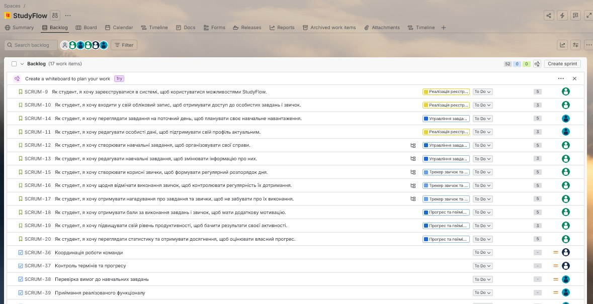
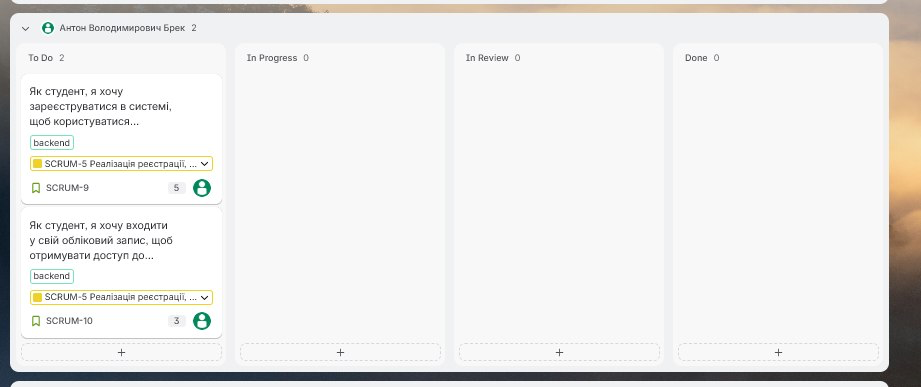
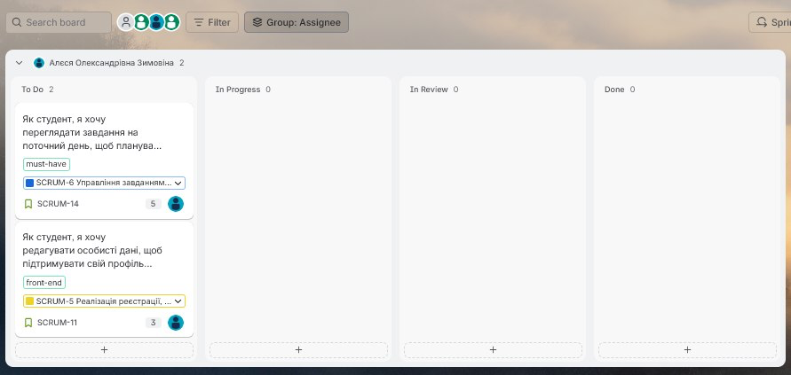
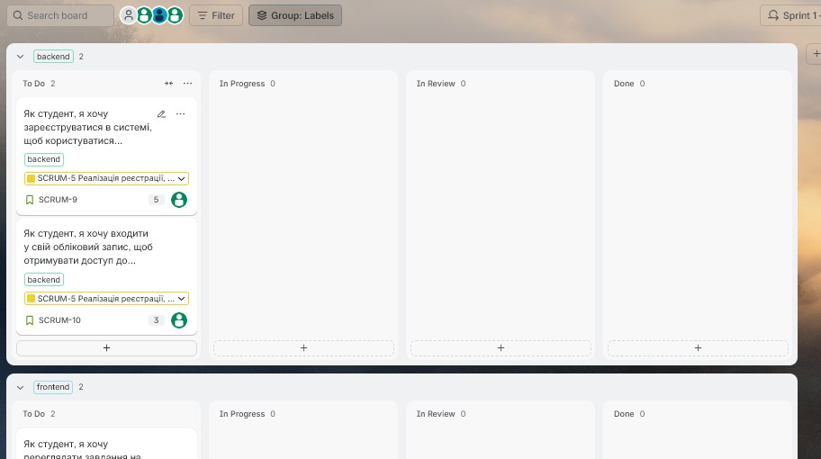
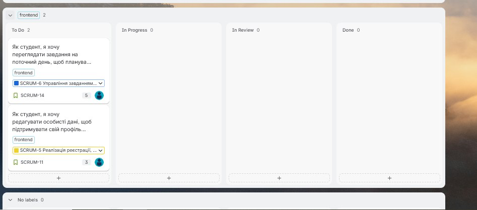
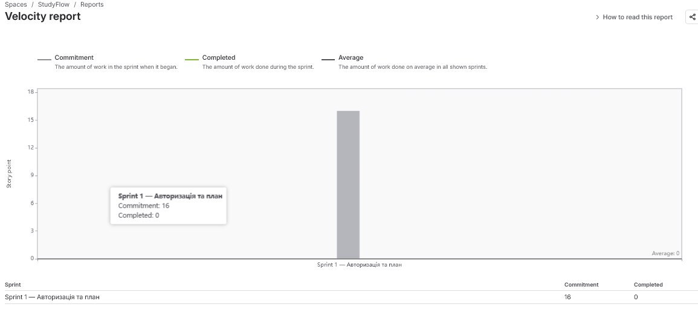

# Ресурсний план проєкту StudyFlow

Jira: [StudyFlow (SCRUM)](https://andretishch.atlassian.net/jira/software/projects/SCRUM/summary)

## 2.1. Склад команди

| Учасник | Ролі в проєкті | Доступність (FTE) | Годин на тиждень |
|---|---|:---:|:---:|
| Олеся Ковальчук | PM / Scrum Master | 0.075 | 3 |
| Брек Антон | Developer (Backend) | 0.075 | 3 |
| Тіщенко Андрій | Analyst + QA | 0.075 | 3 |
| Зимовіна Алєся | Designer + Frontend | 0.075 | 3 |
| Мельник Юра | Product Owner | 0.075 | 3 |
| **Разом** | | **0.375** | **15** |

FTE розраховано від стандартного робочого тижня 40 годин. Ролі відповідають `README.md` та `jira-setup.md`.

У `time-cost-plan.md` для розрахунку вартості було закладено 40 год на людину за спринт. Тут вказана реальна доступність з урахуванням навчання: 3 год на тиждень, тобто 6 год за спринт.

## 2.2. Capacity на спринт

| Параметр | Значення | Коментар |
|---|---|---|
| Тривалість спринту | 2 тижні | Планова тривалість |
| Σ годин команди на спринт | 30 год | 5 учасників × 3 год × 2 тижні |
| Коефіцієнт на непродуктивний час | −20% | Мітинги, обговорення та перевірка роботи |
| Ефективна Capacity | 24 год | 30 − 20% |
| Commitment (Sprint 1) | 16 SP | Дані Jira |
| Completed (Sprint 1) | 0 SP | Дані Jira |
| Velocity (Sprint 1) | 0 SP | Фактично завершені SP |
| Годин на 1 SP (факт) | Не визначено | Capacity ÷ Velocity неможливо: Velocity = 0 |
| Годин на 1 SP (оцінка) | 1,83 год/SP | Σ Original Estimate 42 год ÷ 23 SP (`time-cost-plan.md`) |
| Плановий обсяг наступного спринту | 13 SP | 24 год ÷ 1,83 год/SP ≈ 13 SP |

У Sprint 1 було заплановано 16 Story Points, але завершених задач не було. Тому фактичну кількість годин на 1 SP поки визначити неможливо. Для планування Sprint 2 використано оцінку 1,83 год/SP з Original Estimate у Jira. Це дає не більше 13 SP, тобто менше за 16 SP із Sprint 1. Оцінка оптимістична, бо в ній не враховано дизайн, рев'ю та інтеграцію. Тому після Sprint 2 коефіцієнт треба перерахувати за фактичною Velocity.

## 2.3. Skills Matrix

Оцінка навичок: 0 — немає, 1 — базовий рівень, 2 — впевнений рівень, 3 — сильний рівень.

| Навичка | Олеся | Антон | Андрій | Алєся | Юра | Потрібний рівень | Ризик |
|---|:---:|:---:|:---:|:---:|:---:|:---:|---|
| React / Frontend | 3 | 3 | 3 | 3 | 3 | ≥2 | Низький |
| Node.js / Backend | 1 | 2 | 1 | 1 | 2 | ≥2 | Середній |
| Бази даних | 2 | 3 | 2 | 1 | 2 | ≥2 | Низький |
| Тестування | 2 | 1 | 3 | 2 | 2 | ≥1 | Низький |
| DevOps / Деплой | 2 | 2 | 1 | 2 | 3 | ≥1 | Низький |
| Дизайн / Figma | 3 | 0 | 2 | 3 | 2 | ≥1 | Низький |
| Git / Code Review | 3 | 3 | 3 | 3 | 3 | ≥2 | Низький |

## 2.4. Аналіз Skills Matrix

| Питання | Відповідь |
|---|---|
| Яка навичка покрита лише однією людиною? | За вказаними оцінками немає навички, яка була б на потрібному рівні лише в одного учасника. |
| Який Bus Factor у критичних зонах? | Backend — 2 учасники; Frontend — 5 учасників; бази даних — 4 учасники. |
| Яка навичка потрібна, але відсутня або слабка? | Backend є основною зоною ризику, оскільки впевнений рівень Node.js мають лише Антон і Юра. |
| План закриття розриву | Антон допомагає іншим учасникам покращити знання Node.js та серверної логіки. Алєся покращує знання баз даних за допомогою Антона. До Sprint 3 потрібно повторно оцінити рівень навичок. |

Bus Factor визначений за кількістю учасників з оцінкою не нижче 2.

## 2.5. Зони відповідальності (Labels)

| Label | Area Lead | К-сть задач | Що входить |
|---|---|:---:|---|
| backend | Брек Антон | 12 | API, база даних, бізнес-логіка |
| frontend | Зимовіна Алєся | 10 | Інтерфейс, форми, сторінки |
| qa | Тіщенко Андрій | 10 | Тестування, перевірка Acceptance Criteria |
| infra | Не використовується | 0 | Не передбачено поточним проєктом |
| Без Labels | Не призначено | 5 | Задачі, яким потрібно додати мітки |

Кількість задач отримана через пошук Jira за відповідними Labels. Кількість задач із різними мітками може перетинатися.

Jira-фільтри для пошуку задач:

| Напрямок | JQL-запит |
|---|---|
| Backend | `project = SCRUM AND labels = backend` |
| Frontend | `project = SCRUM AND labels = frontend` |
| QA | `project = SCRUM AND labels = qa` |
| Infra | `project = SCRUM AND labels = infra` |
| Без міток | `project = SCRUM AND labels IS EMPTY` |

## 2.6. Аналіз Workload (з Jira)

| Учасник | Задач у Sprint 1 | SP committed | SP done | % виконання | Висновок |
|---|:---:|:---:|:---:|:---:|---|
| Брек Антон | 2 | 8 | 0 | 0% | Перевантажений: 8 SP ≈ 14,6 год при особистій Capacity 4,8 год за спринт (~3×) |
| Зимовіна Алєся | 2 | 8 | 0 | 0% | Перевантажена: 8 SP ≈ 14,6 год при Capacity 4,8 год (~3×) |
| Тіщенко Андрій | 0 | 0 | 0 | — | Недовантажений: задачі QA не потрапили у спринт |
| Олеся Ковальчук | 0 | 0 | 0 | — | Недовантажена: задачі координації не мають SP і не включені у спринт |
| Мельник Юра | 0 | 0 | 0 | — | Недовантажений: має Backend рівня 2, може допомогти Антону |
| **Разом** | **4** | **16** | **0** | **0%** | 16 SP ≈ 29 год при Capacity команди 24 год |

Дані отримані з пошуку задач завершеного Sprint 1 у Jira. Чотири задачі мали такі Story Points: 5, 3, 3 та 5. Усі задачі мали статус To Do. Відсоток виконання для учасників без запланованих SP не розраховується.

Особиста Capacity за спринт: 3 год × 2 тижні − 20% = 4,8 год ≈ 2,6 SP (при 1,83 год/SP).

## 2.7. Вирівнювання завантаження

| Виявлена проблема | Рішення | Очікуваний результат |
|---|---|---|
| У Sprint 1 задачі були призначені лише Антону та Алєсі | Розподіляти наступні задачі між усіма учасниками відповідно до їхніх ролей | Більш рівномірний розподіл роботи |
| Backend залежить переважно від двох учасників | Залучати Антона та Юру до обміну знаннями | Зменшення залежності від окремих учасників |
| 5 задач не мають Labels | Додати мітки відповідно до напрямку роботи | Кращий розподіл відповідальності |
| 5 задач мають статус Unassigned | Призначити відповідальних учасників | Визначення відповідальності за кожну задачу |
| У Sprint 1 не було завершених SP | Приділити більше уваги завершенню розпочатих задач | Покращення виконання плану наступного спринту |

## 2.8. Ресурсний план по спринтах

| Спринт | Період | Потрібні зони | Capacity (год) | Особливості |
|---|---|---|:---:|---|
| Sprint 1 | 10.11 – 23.11.2026 | Backend, Frontend | 24 | Commitment 16 SP, Completed 0 SP |
| Sprint 2 (N+1) | 24.11 – 07.12.2026 | Backend, Frontend, QA, Design | 24 | План ≤ 13 SP: незавершені Stories Sprint 1 (SCRUM-9, 10, 11, 14) мають пріоритет |
| Sprint 3 (N+2) | 08.12 – 21.12.2026 | Backend, Frontend, QA | 24 | Кінець семестру: можлива знижена доступність через заліки, план уточнити за Velocity Sprint 2 |

Capacity 24 години розрахована для двотижневого спринту за умови незмінної доступності всіх п'яти учасників. Дати спринтів узгоджені з `time-cost-plan.md`.

## 2.9. Скріншоти з Jira

| № | Що на скріншоті | Файл |
|:-:|---|---|
| 1 | Backlog |  |
| 2 | Board по Assignee (Брек Антон) |  |
| 3 | Board по Assignee (Зимовіна Алєся) |  |
| 4 | Board по Labels (backend) |  |
| 5 | Board по Labels (frontend) |  |
| 6 | Velocity report |  |

## 2.10. Висновки

Під час виконання лабораторної роботи було проаналізовано ресурси команди проєкту StudyFlow та налаштовано розподіл відповідальності в Jira за допомогою Labels.

Було визначено доступність кожного учасника, розраховано орієнтовну Capacity команди на двотижневий спринт, а також складено Skills Matrix. Загальна доступність команди становить 15 годин на тиждень, а ефективна Capacity на один спринт — 24 години.

За результатами аналізу Skills Matrix найкраще покриті навички Frontend, Git та тестування. Основною зоною ризику є Backend, оскільки впевнений рівень Node.js мають лише два учасники.

У Jira було проаналізовано розподіл задач за Labels. Було знайдено 12 задач Backend, 10 Frontend та 10 QA. Також виявлено 5 задач без міток та призначених виконавців.

Під час аналізу Sprint 1 було встановлено, що команда запланувала 16 Story Points, але не завершила жодної задачі. Найбільший обсяг запланованої роботи припадав на Антона та Алєсю — по 8 Story Points.

**Хто у команді перевантажений/недовантажений і чому?**
Перевантажені Антон і Алєся: на кожного припало 8 SP (≈ 14,6 год), а особиста Capacity — лише 4,8 год за спринт. Андрій, Олеся та Юра у Sprint 1 не мали задач зі Story Points. Причина: у спринт потрапили лише Stories розробки (backend та frontend), а задачі тестування, аналізу й координації залишилися в беклозі без оцінки.

**Який Bus Factor і як його підвищуємо?**
Найнижчий Bus Factor у Backend — 2 (Антон і Юра). Підвищуємо так: Юра бере частину backend-задач разом з Антоном, Антон проводить code review та пояснює серверну логіку іншим учасникам, Алєся підтягує бази даних. До Sprint 3 повторно оцінюємо Skills Matrix.

**Чи реалістична запланована кількість SP на наступний спринт при поточній Capacity?**
16 SP, як у Sprint 1, — нереалістично: це ≈ 29 год при Capacity 24 год, і за Sprint 1 не завершено жодного SP. Реалістично — не більше 13 SP, з пріоритетом на незавершені Stories Sprint 1. Після Sprint 2 обсяг коригуємо за фактичною Velocity.

**Яка зона має найбільше задач і чи відповідає це кількості людей у ній?**
Найбільше задач у зоні backend — 12. Area Lead лише один (Антон), і ще одна людина має потрібний рівень (Юра). Для frontend (10 задач) і qa (10 задач) також по одному ліду, але frontend-навички мають усі учасники. Отже, backend — головне вузьке місце: до нього треба залучити Юру.

Отримані результати можна використовувати для планування наступних спринтів, рівномірнішого розподілу задач, покращення взаємозаміни учасників команди та підвищення ефективності роботи над проєктом StudyFlow.
